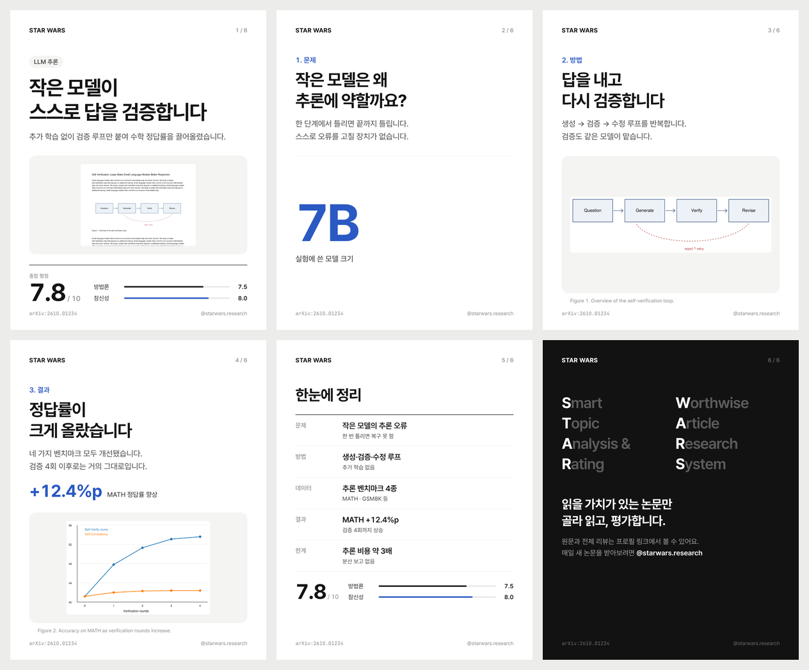
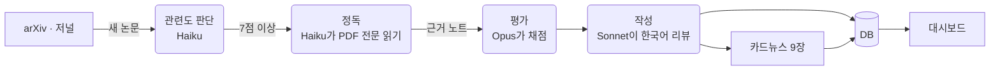
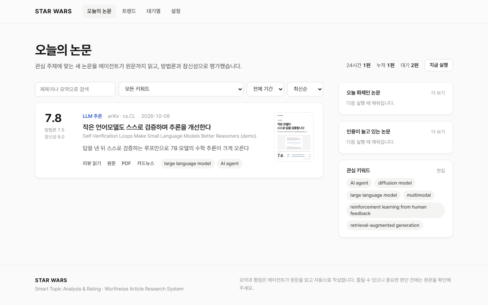
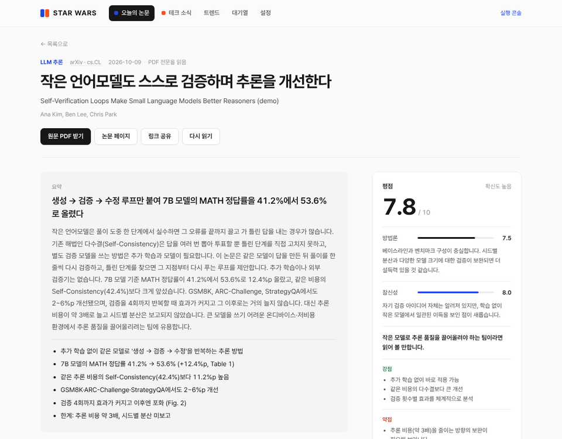

<div align="center">

# STAR WARS

**S**mart **T**opic **A**nalysis & **R**ating : **W**orthwise **A**rticle **R**esearch **S**ystem

읽을 가치가 있는 논문만 골라 읽고, 평가하고, 인스타 카드뉴스로 만드는 Claude 에이전트


[로컬에서 실행](#1-로컬에서-홈페이지-띄워-보기) ·
[명령어](#2-명령어) ·
[테스트](#3-테스트) ·
[Heroku 업데이트](#5-heroku에-변경-사항-올리기) ·
[처음 설정 (API 키·Heroku 첫 배포)](docs/SETUP.md)



<sub>위 카드뉴스와 아래 화면은 데모용 가상 논문으로 만든 예시입니다.</sub>

</div>

---

## 무엇을 하나요

관심 키워드와 arXiv 분야, 저널·학회를 등록해 두면 **12시간마다** 다음을 반복합니다.

| | 단계 | 내용 |
|:-:|---|---|
| 1 | **수집** | arXiv 분야와 저널·학회(NeurIPS, CVPR 같은 학회 포함)에서 키워드에 맞는 새 논문을 모읍니다. 학회 논문은 arXiv에 "Accepted at NeurIPS"처럼 적힌 채택 논문과 OpenAlex 목록에서 찾습니다 |
| 2 | **관련도 판단** | 모은 논문 전부에 0~10점을 매깁니다. 7점 미만은 **관련도 미달**로 남겨 두고, 관리자가 골라서 읽힐 수 있습니다 |
| 3 | **정독 → 평가 → 작성** | PDF 전문을 읽고 **방법론 신뢰도**와 **참신성**으로 채점한 뒤, 한국어 리뷰를 씁니다 |
| 4 | **카드뉴스** | 논문 그림과 핵심 수치로 인스타용 1080×1350 카드 9장(문제·아이디어·작동 방식·실험·결과·평가·정리·프로필 안내)과 캡션을 만듭니다 |
| 5 | **트렌드** | 오늘 화제인 논문, 인용이 빠르게 느는 논문을 모읍니다. 공개 데이터만 쓰므로 **Claude API 없이도** 갱신됩니다 |

결과는 누구나 볼 수 있는 대시보드에 올라가고, 출처(저널·학회·arXiv 분야)별로 나눠 볼 수 있습니다. **설정** 페이지와 키워드·저널 관리, 실행은 관리자만 쓸 수 있습니다.

> [!NOTE]
> **Claude API에 문제가 생겨도 멈추지 않습니다.** API 키가 없거나 틀렸거나 크레딧이 부족하면 AI 단계(관련도 판단·정독·평가·작성)만 건너뜁니다.
> 논문 수집, 트렌드, 기존 리뷰와 카드뉴스는 그대로 동작합니다. 화면 위쪽에는 관리자에게 "API 키를 확인하라"는 안내가 뜨고, 방문자에게는 짧은 안내만 보입니다.
> 키를 고친 뒤 **API 다시 확인**을 누르거나 다음 실행이 돌면 자동으로 다시 읽기 시작합니다.



> [!TIP]
> **비용을 아끼는 구조입니다.** 입력이 가장 큰 PDF 정독은 가장 저렴한 Haiku가 맡습니다. 비싼 Opus는 PDF 대신 짧은 노트만 읽고 점수를 정합니다.
> 기본 설정으로 논문 한 편에 약 $0.15~0.22, 하루 약 $1~1.4가 듭니다. 실제로 쓴 비용은 대시보드 **설정 → 모델과 비용**에서 볼 수 있습니다.

> [!NOTE]
> PDF는 서버의 임시 폴더에서 읽고 바로 지웁니다. 사용자는 대시보드의 **원문 PDF 받기** 버튼으로 arXiv 같은 원문 사이트에서 받습니다.

<table>
<tr>
<td width="50%"><p align="center"><sub>오늘의 논문</sub></p></td>
<td width="50%"><p align="center"><sub>논문 리뷰와 평점</sub></p></td>
</tr>
</table>

---

## 1. 로컬에서 홈페이지 띄워 보기

내 컴퓨터(`127.0.0.1`)에서 대시보드를 실행하는 방법입니다. **API 키가 없어도** 데모 데이터로 모든 화면을 확인할 수 있습니다.

### 준비물

- Python 3.10 이상 (`python3 --version`으로 확인)
- Git

### 1단계: 코드 받기

```bash
git clone https://github.com/SeonGyuJang/STAR_WARS.git
cd STAR_WARS
```

### 2단계: 가상환경 만들고 켜기

<table>
<tr><th>macOS · Linux</th><th>Windows (PowerShell)</th></tr>
<tr><td>

```bash
python3 -m venv .venv
source .venv/bin/activate
```

</td><td>

```powershell
python -m venv .venv
.venv\Scripts\Activate.ps1
```

</td></tr>
</table>

켜지면 터미널 앞에 `(.venv)`가 붙습니다. 새 터미널을 열 때마다 이 명령으로 다시 켜야 합니다.

### 3단계: 패키지와 브라우저 설치

```bash
pip install -r requirements.txt
python -m playwright install chromium     # 카드뉴스를 PNG로 찍는 브라우저 (한 번만)
```

> [!NOTE]
> Linux에서 Chromium 실행에 필요한 시스템 라이브러리가 없다는 오류가 나면 `python -m playwright install --with-deps chromium`을 실행하세요 (`sudo` 권한 필요).

### 4단계: 설정 파일 만들기

```bash
cp .env.example .env        # Windows: copy .env.example .env
```

데모만 볼 때는 `.env`를 고치지 않아도 됩니다. 실제 논문을 리뷰하려면 `.env`에 API 키를 넣으세요.

```bash
ANTHROPIC_API_KEY=sk-ant-...     # 발급 방법: docs/SETUP.md 2장
ADMIN_PASSWORD=test1234          # 넣으면 설정·관리 기능에 로그인이 필요해집니다
```

### 5단계: 데모 데이터 넣기

```bash
python -m paperagent demo
```

`demo paper #1 added - open /paper/1 on the dashboard`가 나오면 성공입니다.
가상 논문 1편이 리뷰와 카드뉴스 9장까지 갖춰 들어가고, 대기열에도 논문 3편이 들어갑니다. API 호출은 하지 않습니다.

### 6단계: 서버 실행

```bash
python -m paperagent serve --host 127.0.0.1 --port 8000 --no-scheduler
```

| 옵션 | 뜻 |
|---|---|
| `--host 127.0.0.1` | 내 컴퓨터에서만 접속 가능 (같은 와이파이의 다른 기기에서도 보려면 `0.0.0.0`) |
| `--port 8000` | 주소의 포트 번호. 이미 쓰는 포트라면 `8080` 등으로 바꾸세요 |
| `--no-scheduler` | 자동 실행 타이머를 끕니다. API 키 없이 데모만 볼 때 쓰세요. 빼면 30초 뒤 실제 수집과 리뷰가 시작됩니다 |

`Running on http://127.0.0.1:8000`이 보이면 준비가 끝난 것입니다. 서버를 끌 때는 터미널에서 <kbd>Ctrl</kbd> + <kbd>C</kbd>를 누릅니다.

### 7단계: 브라우저에서 확인

| 주소 | 확인할 것 |
|---|---|
| http://127.0.0.1:8000 | **오늘의 논문**: 데모 논문 한 편이 점수, 요약, 썸네일과 함께 보이는지. 관리자는 카드 왼쪽 칸을 체크해 인스타 업로드 완료로 표시하고(카드가 초록색으로 바뀜), **인스타에 올린 논문** 탭에서 모아 보거나 취소할 수 있습니다. 실행 중에는 오른쪽 위 **논문 읽는 중**을 누르면 진행 상황과 로그가 나옵니다 |
| http://127.0.0.1:8000/paper/1 | **논문 리뷰**: 평점 막대, 단계별 요약, 주요 그림, 카드뉴스 넘겨보기, 캡션 복사 |
| http://127.0.0.1:8000/files/cards/1.zip | **카드뉴스 ZIP**: PNG 9장과 `caption.txt`가 들어 있는지 |
| http://127.0.0.1:8000/queue | **대기열**: 맨 위에 실행 상태(지금 실행 / 강제 종료)와 **다음 실행에서 읽을 논문**이 읽을 순서대로 나옵니다. 체크박스로 골라 **지금 읽기** / **다음 실행 때 먼저 읽기** / **읽지 않기** |
| http://127.0.0.1:8000/settings | **설정** (관리자 전용): 키워드, 논문 출처(저널·학회·arXiv 분야와 출처별 논문 수), 실행 간격, API 상태, 단계별 모델과 비용, 실행 기록 (한국 시간) |
| http://127.0.0.1:8000/trending | **트렌드**: 비어 있으면 **지금 새로고침**을 누르세요 (인터넷 필요, API 키 불필요) |
| http://127.0.0.1:8000/api/status | 서버 상태(JSON) |

**관리자 판단 규칙**
- **`ADMIN_PASSWORD`를 넣었을 때:** 오른쪽 위 **관리자 로그인**으로 로그인해야 설정 메뉴와 관리 기능이 보입니다.
- **비워 두었을 때:** 이 컴퓨터(`127.0.0.1`)에서 접속한 경우에만 관리자로 봅니다. 그래서 로컬 테스트는 로그인 없이 할 수 있습니다.
- **공개 서버(Heroku 등)에서 비워 두었을 때:** 아무도 관리자가 될 수 없으니, 반드시 `ADMIN_PASSWORD`를 설정하세요.

### 8단계: 실제 논문으로 해 보기 (API 키 필요)

```bash
python -m paperagent review 1706.03762      # "Attention Is All You Need"를 바로 리뷰 (1~3분)
```

끝나면 대시보드를 새로고침하세요. 실행 기록과 비용은 **설정** 페이지에서 볼 수 있습니다.

### 정리하기

```bash
python -m paperagent demo --clear     # 데모 데이터만 지우기
rm -rf data                           # 로컬 DB와 이미지를 모두 지우고 처음부터 (Windows: rmdir /s data)
```

---

## 2. 명령어

모든 명령은 저장소 폴더에서 가상환경을 켠 상태로 실행합니다. Heroku에서는 앞에 `heroku run`을 붙입니다 (예: `heroku run python -m paperagent demo`).

| 명령 | 하는 일 | 언제 쓰나 |
|---|---|---|
| `python -m paperagent serve` | 대시보드 실행 (기본 `0.0.0.0:8000`, 자동 실행 타이머 포함) | 로컬에서 계속 돌릴 때 |
| `python -m paperagent serve --host 127.0.0.1 --port 8000 --no-scheduler` | 타이머 없이 대시보드만 실행 | 화면만 확인할 때 |
| `python -m paperagent run` | 수집 → 관련도 판단 → 정독·평가 → 카드뉴스 → 트렌드를 지금 1회 실행 | 바로 돌려 보고 싶을 때 |
| `python -m paperagent run --if-due` | 설정한 간격이 지났을 때만 1회 실행 | Heroku Scheduler, cron |
| `python -m paperagent review <arXiv ID 또는 링크>` | 특정 논문 한 편을 바로 리뷰 | 원하는 논문을 직접 넣을 때 |
| `python -m paperagent cards <논문 번호>` | 저장된 리뷰로 카드뉴스만 다시 렌더링 (Claude 호출 없음) | 카드 디자인을 고친 뒤 |
| `python -m paperagent trending` | 트렌드 패널만 갱신 (Claude 호출 없음, 외부 사이트 조회) | 트렌드 화면 확인 |
| `python -m paperagent demo` | 가상 논문과 카드뉴스 넣기 (인터넷·API 키 필요 없음) | 화면 확인, 시연 |
| `python -m paperagent demo --clear` | 데모 데이터 지우기 | 시연이 끝난 뒤 |
| `python -m paperagent initdb` | DB 테이블 만들기·새 컬럼 추가 | Heroku 배포 때 자동 실행 |
| `python -m pytest tests` | 테스트 실행 | 수정한 뒤 |

<details>
<summary><b>예시 모음</b></summary>

```bash
# 논문 번호 12의 카드뉴스를 다시 만들기 (번호는 주소 /paper/12 의 숫자)
python -m paperagent cards 12

# 링크 그대로 넣어도 됩니다
python -m paperagent review https://arxiv.org/abs/2410.01234

# 포트를 바꿔 실행
python -m paperagent serve --host 127.0.0.1 --port 8080

# 데이터 위치를 바꿔서 실행 (기본: ./data)
DATA_DIR=/tmp/starwars-test python -m paperagent serve --no-scheduler
```

</details>

대시보드에서도 같은 일을 할 수 있습니다.
- **설정 → 실행**: 지금 한 번 실행, arXiv 링크로 바로 리뷰
- **논문 페이지**: 다시 읽기, 카드 다시 만들기
- **대기열**: 관련도 미달·오류 논문을 골라 지금 읽기, 또는 다음 실행 때 먼저 읽기
- **트렌드**: 지금 새로고침 (Claude API 불필요)
- **설정 → 모델과 비용**: API 다시 확인

---

## 3. 테스트

```bash
pip install pytest
python -m pytest tests             # 약 15초, 34개
```

외부 사이트와 Claude API는 가짜 응답으로 대체하므로 인터넷과 API 키 없이 돌아갑니다. 확인하는 내용은 아래와 같습니다.
- 수집·스크리닝·리뷰·카드뉴스 전체 흐름
- 단계별 모델과 비용 계산
- PDF가 끝나면 지워지는지
- 관리자 권한과 CSRF 방어, 설정 페이지 접근 제한
- API 키 없음·잘못된 키일 때 AI만 건너뛰고 수집·트렌드는 진행되는지
- 관련도 미달 논문을 골라 읽히기, 한국 시간 표시
- 중복 실행 방지
- 새 컬럼 자동 추가

<details>
<summary><b>Heroku와 같은 Postgres로 테스트하기</b></summary>

로컬에 Postgres가 있다면 Heroku와 같은 조건(Postgres + DB 이미지 저장)으로 전체 테스트를 돌릴 수 있습니다.

```bash
createdb starwars_test
TEST_DATABASE_URL=postgresql://localhost/starwars_test python -m pytest tests
```

로컬 서버도 Postgres로 띄울 수 있습니다.

```bash
DATABASE_URL=postgresql://localhost/starwars_test python -m paperagent demo
DATABASE_URL=postgresql://localhost/starwars_test python -m paperagent serve --host 127.0.0.1 --no-scheduler
```

</details>

---

## 4. Heroku 첫 배포

처음 한 번만 하는 과정입니다. 앱 만들기, 빌드팩, Postgres·Scheduler 애드온, 환경 변수, 스케줄러 등록까지 **[docs/SETUP.md 4장](docs/SETUP.md#4-heroku-첫-배포)**에 순서대로 정리했습니다.

---

## 5. Heroku에 변경 사항 올리기

코드를 고친 뒤 운영 중인 Heroku 앱에 반영하는 순서입니다. 처음 배포가 끝나 있다고 가정합니다.

### ① 로컬에서 고치고 확인하기

```bash
source .venv/bin/activate            # 가상환경 켜기 (Windows: .venv\Scripts\Activate.ps1)
python -m pytest tests               # 테스트가 모두 통과하는지
python -m paperagent serve --host 127.0.0.1 --no-scheduler   # 화면 확인 후 Ctrl+C
```

> [!TIP]
> 카드뉴스 디자인(`paperagent/templates/cards/cards.html`)을 고쳤다면 `python -m paperagent demo`로 바로 결과를 볼 수 있습니다.
> 결과 이미지는 `data/cards/<번호>/` 폴더에 생깁니다.

### ② 변경 내용 커밋하기

```bash
git status                           # 바뀐 파일 확인
git add -A                           # .env 와 data/ 는 .gitignore 때문에 올라가지 않습니다
git commit -m "카드뉴스 표지 문구 수정"
```

### ③ GitHub에 올리기 (코드 보관용)

```bash
git push origin main                 # 지금 브랜치가 main 이 아니면 그 브랜치 이름으로
```

### ④ Heroku에 올리기 (실제 배포)

```bash
heroku git:remote -a my-starwars     # 이 컴퓨터에서 처음 한 번만. heroku 원격 저장소 연결
git push heroku main                 # main 브랜치를 배포
```

> [!IMPORTANT]
> Heroku는 자기 쪽 `main` 브랜치에 들어온 코드만 배포합니다. 다른 브랜치에서 작업했다면 `로컬브랜치:main` 형태로 보내세요.
> ```bash
> git push heroku claude/blissful-heisenberg-ybixq0:main
> ```

### ⑤ 배포 로그 확인

`git push heroku` 출력에서 다음 순서가 보이면 정상입니다.

| 순서 | 출력 | 뜻 |
|:-:|---|---|
| 1 | `Building on the Heroku-24 stack` · `Installing requirements with pip` | 빌드 (`requirements.txt`가 바뀌었으면 새 패키지도 설치) |
| 2 | `Running release command...` · `database ready` | `python -m paperagent initdb` 실행. 새 테이블과 새 컬럼이 자동으로 추가됨 |
| 3 | `Released v12` · `deployed to Heroku` | 새 버전 배포 완료. 웹 dyno가 자동으로 재시작됨 |

### ⑥ 동작 확인

```bash
heroku ps                            # web.1: up 이면 정상
heroku logs --tail                   # 실시간 로그 (Ctrl+C로 종료)
heroku open                          # 브라우저로 열어서 화면 확인
```

수정한 기능을 바로 확인하고 싶다면 아래 명령을 씁니다.

```bash
heroku run python -m paperagent cards 12                                # 카드 디자인만 고친 경우
heroku run:detached --size=standard-2x python -m paperagent run         # 전체 실행을 지금 한 번
```

### ⑦ 설정값만 바꿀 때 (코드 수정 없음)

```bash
heroku config:set JUDGE_EFFORT=medium        # 값 추가·변경 → 앱이 자동 재시작
heroku config:unset JUDGE_EFFORT             # 값 삭제 (기본값으로)
heroku config                                # 현재 값 확인
```

실행 간격, 정독 수, 최소 관련도, 키워드, 저널은 재배포 없이 **대시보드 설정 페이지**에서 바꾸면 됩니다.

### ⑧ 문제가 생기면 되돌리기

```bash
heroku releases                      # 배포 기록 (v11, v12 ...)
heroku rollback v11                  # 바로 전 버전으로 되돌리기
```

롤백은 코드만 되돌립니다. DB 데이터는 그대로입니다. 고친 뒤에는 ②~④를 다시 하면 됩니다.

<details>
<summary><b>GitHub에 push하면 자동으로 배포되게 하기 (선택)</b></summary>

1. Heroku 대시보드 → 앱 → **Deploy** 탭
2. **Deployment method**에서 **GitHub**을 선택하고 저장소를 연결합니다
3. **Automatic deploys**에서 배포할 브랜치(예: `main`)를 고르고 **Enable Automatic Deploys**를 누릅니다

이후에는 ③ `git push origin main`만 하면 Heroku가 자동으로 ④~⑤를 진행합니다.

</details>

---

## 6. 프로젝트 구조

```
STAR_WARS/
├── paperagent/
│   ├── collectors/          arXiv · 저널·학회(venues) · OpenAlex · 트렌드 수집
│   ├── agent.py             Claude 단계별 호출 (관련도 · 정독 · 평가 · 작성)과 비용 계산
│   ├── pipeline.py          한 번의 실행: 수집 → 판단 → 리뷰 → 카드뉴스 → 트렌드
│   ├── pdfs.py              PDF 임시 다운로드, 그림 추출
│   ├── cardnews.py          카드뉴스 렌더링 (Chromium)
│   ├── db.py                DB (로컬 SQLite / Heroku Postgres)
│   ├── storage.py           이미지 저장 (로컬 파일 / DB)
│   ├── scheduler.py         로컬용 자동 실행 타이머
│   ├── demo.py              데모 데이터
│   ├── web.py               대시보드 라우트
│   ├── templates/           대시보드와 카드뉴스 HTML
│   └── static/              CSS · JS · 글꼴
├── tests/                   pytest
├── docs/SETUP.md            처음 설정 (API 키 · 비용 · Heroku 첫 배포 · 문제 해결)
├── Procfile · app.json · .python-version · .slugignore    Heroku 설정
├── requirements.txt
└── .env.example             환경 변수 예시
```

<details>
<summary><b>디자인 원칙</b></summary>

[awesome-claude-design](https://github.com/VoltAgent/awesome-claude-design)에 정리된 Vercel·Linear·Notion 계열의 원칙을 따랐습니다.

- **서체 하나:** Pretendard만 씁니다. 고정폭 글꼴은 arXiv ID에만 씁니다.
- **문장형 제목:** 대문자 라벨이나 장식 아이콘 대신 평범한 한국어 제목을 씁니다.
- **색은 최소한:** 흰 바탕, 잉크 `#171717`, 포인트 컬러 코발트 `#2B59C3` 한 가지입니다. 다크 모드를 지원합니다.
- **카드 한 장에 메시지 하나:** 단계 → 헤드라인 → 두 줄 설명 → 그림이나 핵심 수치 순서를 지킵니다.

카드뉴스 디자인은 `paperagent/templates/cards/cards.html` 한 파일에 있습니다.

</details>

---

<div align="center">
<sub>요약과 평점은 에이전트가 원문을 읽고 자동으로 작성합니다. 틀릴 수 있으니 중요한 판단 전에는 원문을 확인하세요.<br>
글꼴: Pretendard, JetBrains Mono (SIL Open Font License 1.1)</sub>
</div>
