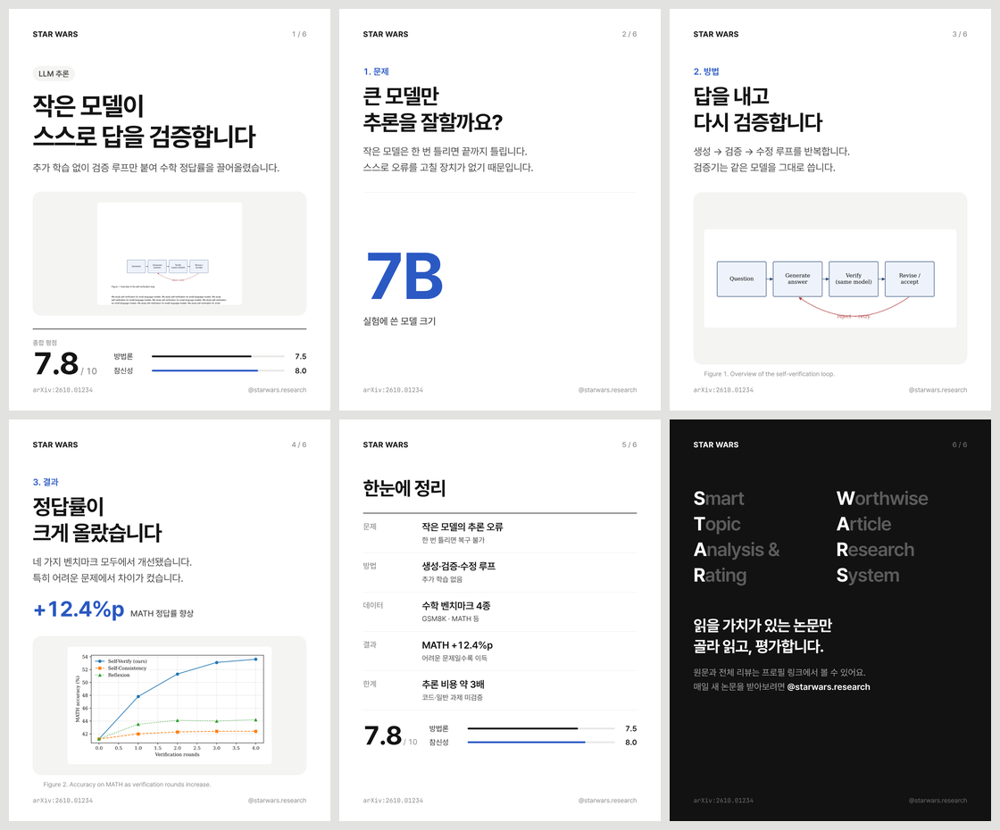
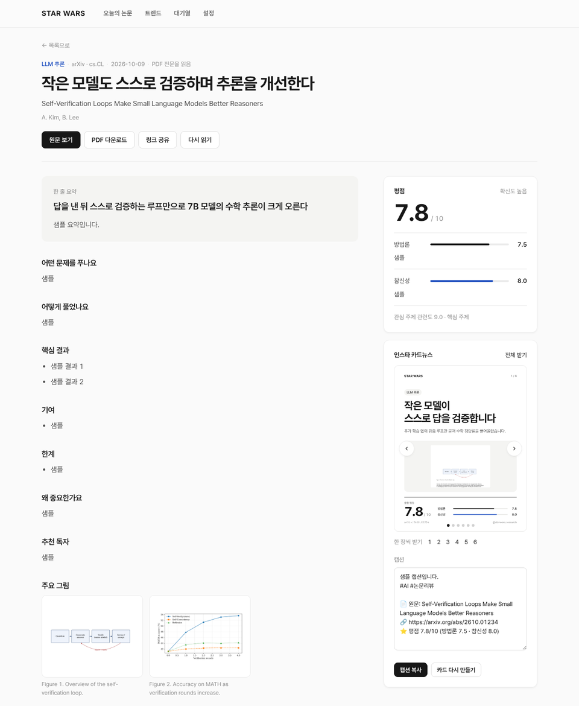

# STAR WARS

**S**mart **T**opic **A**nalysis & **R**ating : **W**orthwise **A**rticle **R**esearch **S**ystem

읽을 가치가 있는 논문만 골라 읽고, 평가하고, 정리하는 Claude 에이전트 + 대시보드 + 인스타 카드뉴스.

관심 키워드와 저널을 등록해 두면 에이전트가 **N시간마다** 새 논문을 찾습니다. 찾은 논문은 **PDF 전문을 읽고**
**방법론 신뢰도·참신성**으로 평점을 매긴 뒤 한국어로 요약합니다. 결과는 누구나 볼 수 있는 Flask 대시보드에 올라가고,
공유용 **인스타 카드뉴스(1080×1350, 6장)**도 자동으로 만들어집니다.

```
 ┌──────────── 매 N시간 (APScheduler) ────────────────────────────────────────────┐
 │ 1. 수집      arXiv API(BeautifulSoup 파싱) · OpenAlex(저널/학회)               │
 │ 2. 스크리닝  Claude가 초록으로 관련도 0~10 판단 → 기준 미만은 건너뜀            │
 │ 3. 정독      PDF를 서버 임시 폴더에 받음 → Claude가 전문(본문·표·그림)을 읽고    │
 │              평점·요약 (JSON 스키마) → Figure 추출 후 PDF 삭제                   │
 │ 4. 카드뉴스  추출한 Figure + 리뷰 → HTML 템플릿 → Chromium으로 PNG 렌더         │
 │ 5. 트렌드    HF Daily Papers 화제성 · OpenAlex 인용 급증/다인용 · 인용 스냅샷    │
 └────────────────────────────────────────────────────────────────────────────────┘
                     ↓ SQLite (data/paperagent.db)
         Flask 대시보드: 오늘의 논문 · 논문 상세 · 트렌드 · 대기열 · 관심 설정
```

## 주요 기능

| 영역 | 내용 |
|---|---|
| 논문 수집 | arXiv 카테고리(cs.AI/CL/LG/CV 기본)와 저널(JMLR, TPAMI, Nature MI, TMLR 기본)에서 키워드에 맞는 새 논문 수집 |
| PDF 처리 | PDF는 서버 임시 폴더에 받아 Claude가 읽고 그림을 뽑은 뒤 바로 삭제. 사용자에게는 arXiv 같은 **원문 PDF 링크**를 제공 (서버에 PDF를 쌓지 않음) |
| 에이전트 리뷰 | Claude(`claude-opus-5-5`)가 PDF를 문서 블록으로 직접 읽음(텍스트·표·그림 포함). 한 줄 요약, TL;DR, 문제, 방법, 핵심 결과, 기여, 한계, 의의, 추천 독자를 작성 |
| 평점 | **방법론 신뢰도**(베이스라인·ablation·재현성·근거의 충분성)와 **참신성·기여도**를 각각 1~10점으로 매기고 근거를 함께 적음. 종합 점수는 두 점수의 평균 |
| 대시보드 | 최신순·평점순·관련도순 정렬, 키워드·기간 필터, 검색, 공유 링크(OG 이미지 포함), JSON API(`/api/papers`) |
| 트렌드 | 🔥 오늘 화제(Hugging Face Daily Papers 추천 수) · 📈 인용 급증(올해 연환산 인용 − 작년 인용) · 🧪 최근 1년 다인용 · ⭐ 리뷰한 논문의 7일 인용 증가(Semantic Scholar 스냅샷) · 키워드별 14일 신규 논문 차트 |
| 관리 | 대시보드에서 키워드 추가·삭제, 저널 검색 후 추가(OpenAlex), arXiv 카테고리 추가, 소스 켜기·끄기, 실행 간격·리뷰 수·관련도 기준 변경, 즉시 실행, arXiv 링크로 특정 논문 바로 리뷰 |
| 카드뉴스 | 표지(헤드라인·평점) → 문제 → 방법 → 결과(논문 Figure와 핵심 수치) → 요약 표 → 아웃트로 순서의 6장. 슬라이드별 PNG와 ZIP을 내려받을 수 있고, 해시태그가 포함된 인스타 캡션도 만듦 |

카드뉴스 예시 (테스트용 가상 논문으로 렌더링):



논문 상세 페이지:



### 디자인 원칙

[awesome-claude-design](https://github.com/VoltAgent/awesome-claude-design)에 정리된 Vercel·Linear·Notion 계열 DESIGN.md의 원칙을 따랐습니다. 장식보다 내용이 먼저 보이게 하는 데 집중했습니다.

- **서체는 하나**: Pretendard(400·500·600·700)만 씁니다. 고정폭 글꼴은 arXiv ID 같은 식별자에만 씁니다.
- **문장형 제목**: 대문자 라벨과 넓은 자간 대신 문장형 한국어 제목을 쓰고, 제목 자간은 살짝 좁혔습니다.
- **색은 최소한**: 흰 바탕, 잉크 `#171717`, 본문 회색 `#4D4D4D`, 포인트 컬러 코발트 `#2B59C3` 한 가지입니다. 다크 모드를 지원합니다.
- **장식 대신 여백과 헤어라인**: 그라데이션·아이콘·이모지 장식을 쓰지 않습니다. 카드는 1px 테두리와 아주 옅은 그림자만 씁니다.
- **카드뉴스 한 장에 메시지 하나**: 단계 → 헤드라인 → 두 줄 설명 → 논문 그림·핵심 수치 순서로 위계를 고정했습니다. 로고와 쪽수는 늘 같은 자리에 둡니다.

## 빠른 시작

```bash
python -m venv .venv && source .venv/bin/activate
pip install -r requirements.txt
playwright install chromium        # 카드뉴스 렌더링용 (이미 Chromium이 있으면 CHROMIUM_EXECUTABLE로 지정)

cp .env.example .env               # ANTHROPIC_API_KEY, SECRET_KEY, ADMIN_PASSWORD 등 입력 (docs/SETUP.md 참고)
python -m paperagent serve --port 8000
```

> **API 키 발급, 비용, 방화벽 허용 목록, systemd·HTTPS 배포, 문제 해결은 [docs/SETUP.md](docs/SETUP.md)에 단계별로 정리했습니다.**

`http://<서버IP>:8000`에 접속하면 됩니다. 서버를 띄우고 30초 뒤 첫 실행이 시작되고, 이후 설정한 간격마다 반복합니다.

### 명령어

```bash
python -m paperagent serve            # 대시보드 + 스케줄러
python -m paperagent run              # 파이프라인 1회 즉시 실행 (cron으로 돌릴 때도 사용)
python -m paperagent review 2410.01234  # 특정 arXiv 논문을 바로 리뷰
python -m paperagent cards 12         # 12번 논문 카드뉴스 다시 렌더
python -m paperagent trending         # 트렌드 패널만 갱신
python -m pytest tests                # 테스트
```

### 외부에 공개하기 (누구나 접속)

```bash
gunicorn -w 1 --threads 8 -b 0.0.0.0:8000 wsgi:app
```

- 스케줄러가 하나만 돌도록 **워커는 1개**로 두세요. 스레드 수는 늘려도 됩니다.
- 대시보드는 누구나 볼 수 있습니다. `ADMIN_PASSWORD`를 설정하면 키워드·저널 변경과 실행은 로그인한 관리자만 할 수 있습니다.
- 앞단에 Nginx/Caddy로 HTTPS를 붙이거나, 간단히 공유하려면 `cloudflared tunnel --url http://localhost:8000`을 쓰면 됩니다.

## 설계 메모

- **Google Scholar 미사용**: Scholar는 공개 API가 없고 자동 접근을 약관으로 금지하며 CAPTCHA로 막습니다. 대신 Scholar가 색인하는 메타데이터 대부분을 담은 **OpenAlex**(저널·학회·인용 수, 무료, 키 불필요)와 **Semantic Scholar**를 씁니다. 저널 이름으로 검색해서 바로 추가할 수 있습니다.
- **Selenium 대신 arXiv API + BeautifulSoup**: arXiv는 봇이 HTML을 긁지 말고 `export.arxiv.org` API를 쓰도록 요청합니다. 요청 사이에 3초 간격을 지키고, Atom 피드는 BeautifulSoup으로 파싱합니다. 브라우저 자동화가 필요 없으므로 더 빠르고 덜 깨집니다.
- **전문 읽기**: PDF(최대 약 30MB·600쪽)를 base64 문서 블록으로 그대로 보내므로, Claude가 본문뿐 아니라 표와 그림도 봅니다. 이보다 크면 추출한 텍스트를 보내고, 오픈 액세스 PDF가 없는 저널 논문은 초록만 읽은 뒤 `초록만` 배지를 붙입니다.
- **구조화 출력**: 리뷰와 카드 문구는 JSON 스키마(`output_config.format`)로 받으므로 파싱이 실패하지 않습니다. 점수는 1~10 범위로 고정하고, 추출하지 못한 Figure 번호는 버립니다.
- **거절 대비**: Claude API의 서버 측 `fallbacks: "default"`를 켜 두었습니다. Bedrock/Vertex/Foundry를 쓴다면 `CLAUDE_FALLBACKS=0`으로 끄세요.
- **비용 조절**: 실행당 정독 수(`MAX_FULL_READS`, 기본 5)와 최소 관련도(`MIN_RELEVANCE`, 기본 6)로 조절합니다. 스크리닝만 저렴한 모델로 돌리려면 `SCREEN_MODEL=claude-haiku-5-5`를 쓰세요. 전문 리뷰 1건은 대략 PDF 30~80k 입력 토큰입니다.
- **Figure 추출**: PyMuPDF로 각 "Figure N" 캡션 바로 위에 있는 래스터·벡터 그래픽 영역을 잘라 냅니다. Claude가 슬라이드마다 어떤 Figure를 쓸지 고릅니다(방법 슬라이드에는 개요도, 결과 슬라이드에는 결과 그래프나 표).

## 카드뉴스 커스터마이징

- 디자인: `paperagent/templates/cards/cards.html` (HTML/CSS 한 파일, 1080×1350)
- 브랜드: `.env`의 `CARD_BRAND`, `CARD_HANDLE`(인스타 계정), `BRAND_TAGLINE` · 약어 풀이는 `config.BRAND_ACRONYM`
- 폰트: Pretendard와 JetBrains Mono(식별자 전용)가 `paperagent/static/fonts`에 들어 있음 (모두 SIL OFL 1.1)
- 문구를 손보고 다시 만들고 싶으면 논문 상세 페이지의 "카드뉴스 다시 만들기"를 누르거나 `python -m paperagent cards <id>`를 실행

## 디렉터리

```
paperagent/
  collectors/   arxiv.py · openalex.py · trending.py
  agent.py      Claude 스크리닝 + 전문 리뷰 (JSON 스키마)
  pdfs.py       PDF 임시 다운로드 · Figure 추출
  cardnews.py   카드뉴스 렌더러 (Playwright)
  pipeline.py   수집→스크리닝→정독→카드→트렌드 한 사이클
  scheduler.py  N시간 반복
  web.py        Flask 라우트 · templates/ · static/
tests/          pytest (네트워크·Claude 호출은 mock 처리)
```

> 논문 요약과 평점은 에이전트가 자동으로 만든 것이라 틀릴 수 있습니다. 중요한 판단을 하기 전에는 원문을 확인하세요.
