<div align="center">

# STAR WARS

**S**mart **T**opic **A**nalysis & **R**ating : **W**orthwise **A**rticle **R**esearch **S**ystem

**읽을 가치가 있는 논문과 기술 소식만 골라, 끝까지 읽고, 쉽게 풀어 주는 AI 연구 비서**

[둘러보기](#-화면별-기능) · [시작하기](#-시작하기) · [자주 묻는 질문](#-자주-묻는-질문)

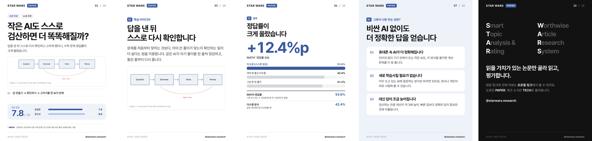

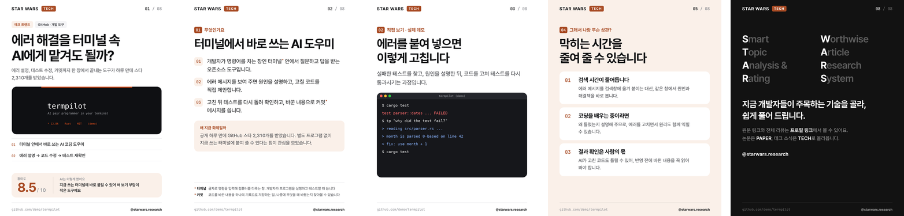

<sub>이 문서의 화면과 카드뉴스는 모두 데모용 가상 논문·가상 프로젝트로 만든 예시입니다.</sub>

</div>

---

## STAR WARS가 하는 일

관심 키워드만 등록해 두면, 매일 쏟아지는 논문과 기술 소식 중 **읽을 가치가 있는 것만** 골라 정리해 줍니다.

| | 📄 논문 (PAPER) | 🛠️ 테크 소식 (TECH) |
|---|---|---|
| **어디서** | arXiv 분야, 저널, 학회(NeurIPS, CVPR 등) | GitHub Trending, Hacker News, GeekNews, Hugging Face |
| **고르는 기준** | 관심 키워드와의 관련도 (0~10점) | 일반 독자와 개발자에게 흥미로운 정도 (0~10점) |
| **읽는 범위** | PDF 전문 | 소개 글이 가리키는 원문 기사 · GitHub 저장소 · 논문까지 |
| **결과** | 방법론 · 참신성 평점과 한국어 리뷰 | 쉬운 한국어 설명 |
| **카드뉴스** | 남색 PAPER 카드 10장 + 캡션 | 테라코타색 TECH 카드 + 캡션 |

이 과정은 12시간마다 자동으로 돌고, 결과는 누구나 볼 수 있는 대시보드에 올라갑니다. 설정을 바꾸거나 직접 실행하는 일은 관리자만 할 수 있습니다.

---

## 🧭 화면별 기능

위쪽 메뉴는 **오늘의 논문 · 테크 소식 · 트렌드 · 대기열 · 설정** 다섯 개입니다.

### 1. 오늘의 논문

에이전트가 끝까지 읽고 평가한 논문이 모이는 첫 화면입니다.

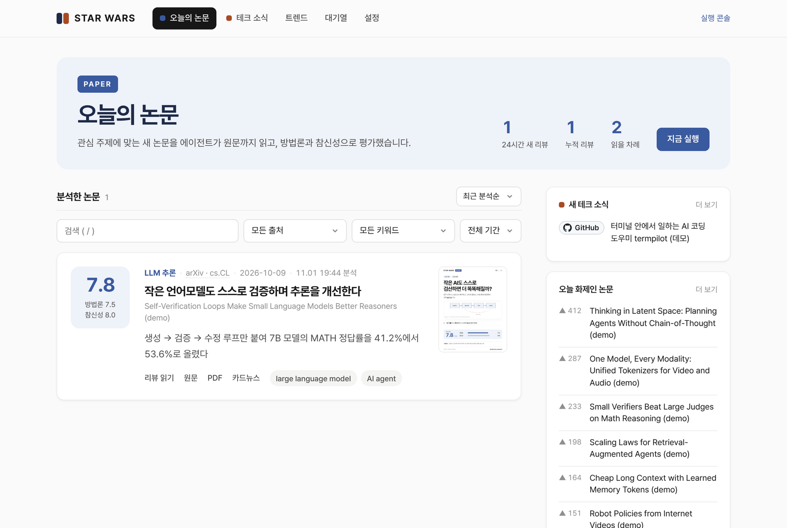

- **논문 카드:** 왼쪽에 종합 평점(방법론 · 참신성)을, 가운데에 한국어 제목, 원래 제목, 한 줄 요약을 보여 줍니다. 카드뉴스 표지 미리보기도 함께 나옵니다.
- **바로가기:** 카드마다 **리뷰 읽기 · 원문 · PDF · 카드뉴스** 링크와 해당 키워드가 붙어 있습니다.
- **찾기와 정렬:** 검색(키보드 `/`), 출처(arXiv 분야 · 저널 · 학회), 키워드, 기간(24시간 · 7일 · 30일)으로 거를 수 있습니다. 정렬은 최근 분석순 · 평점순 · 관련도순입니다.
- **오른쪽 패널:** 새 테크 소식, 오늘 화제인 논문, 인용이 늘고 있는 논문, 출처별 논문 수, 관심 키워드가 있습니다. 출처 이름을 누르면 그 출처의 논문만 볼 수 있습니다.

### 2. 논문 리뷰

논문 하나를 누르면 리뷰 전체를 볼 수 있습니다. 논문을 직접 읽기 전에 핵심을 빠르게 파악하는 용도입니다.

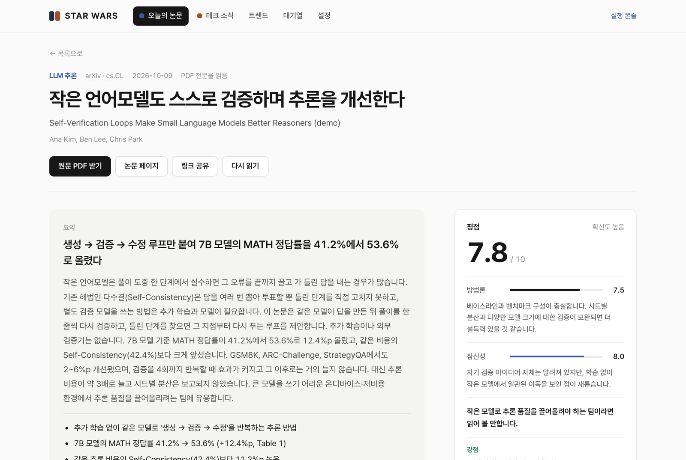

- **리뷰 본문:** 아래 순서로 정리합니다.
  - 요약
  - 어떤 문제를 푸나요 · 배경
  - 핵심 아이디어 · 어떻게 풀었나요
  - 실험 설정 · 핵심 결과 · 분석과 추가 실험
  - 기여 · 기존 연구와 다른 점 · 왜 중요한가요
  - 한계 · 추천 독자 · 용어 정리
  - 논문에서 뽑은 **주요 그림**과 초록
- **평점:** 방법론 신뢰도와 참신성 점수, 각각의 이유, 에이전트가 얼마나 확신하는지(확신도)를 보여 줍니다.
- **버튼:** 원문 PDF 받기, 논문 페이지, 링크 공유, **다시 읽기**(처음부터 다시 읽고 리뷰를 새로 씀)가 있습니다.
- **카드뉴스 칸:** 오른쪽에서 이 논문의 카드뉴스를 넘겨 보고 받을 수 있습니다. 자세한 내용은 [카드뉴스](#3-카드뉴스)에 있습니다.

### 3. 카드뉴스

논문 리뷰와 테크 소식 페이지 오른쪽에 있는 카드뉴스 칸입니다. 인스타그램 규격(1080×1350)으로 만들어 바로 올릴 수 있습니다.

<table>
<tr>
<td width="62%">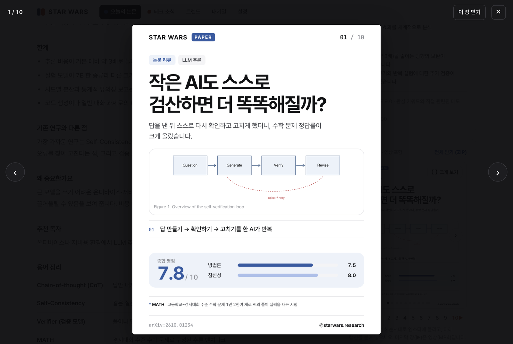</td>
<td width="38%" align="center">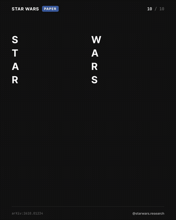</td>
</tr>
<tr>
<td align="center"><sub><b>크게 보기</b>: 전체 화면에서 ← → · 스와이프로 넘기기, Esc로 닫기</sub></td>
<td align="center"><sub>마지막 장은 글자가 움직이는 MP4 영상</sub></td>
</tr>
</table>

- **논문 카드뉴스(10장):** 질문형 표지 → 문제 → 핵심 아이디어 → 작동 방식 → 실험 → 결과(큰 숫자와 막대) → **그래서 나랑 무슨 상관?** → 평가 → 정리 → 마지막 장
- **테크 카드뉴스:** 질문형 표지 → 무엇인가요 → 실제 데모(원본 데모 영상이 내용과 맞을 때만) → 어떻게 작동하나요 → 그래서 나랑 무슨 상관? → 직접 써보기 → 정리 → 마지막 장
- **표지:** 그림과 핵심 요점 3줄을 넣습니다. 그림이 없으면 핵심 수치를 크게 보여 줍니다. 테크 표지에는 흥미도와 AI 한줄평이 들어갑니다.
- **받기:** **이 장 받기**, **전체 받기 (ZIP)**(카드 이미지, 마지막 장 영상, `caption.txt`), **캡션 복사**가 있습니다. ZIP 안의 파일 번호 순서대로 올리면 됩니다.
- **고치기:** 관리자는 **카드 다시 만들기**로 카드만 새로 그릴 수 있습니다. 리뷰 내용은 그대로 둡니다.

### 4. 테크 소식

지금 개발자들이 주목하는 프로젝트와 기술 뉴스를 쉬운 한국어로 풀어 놓은 화면입니다.

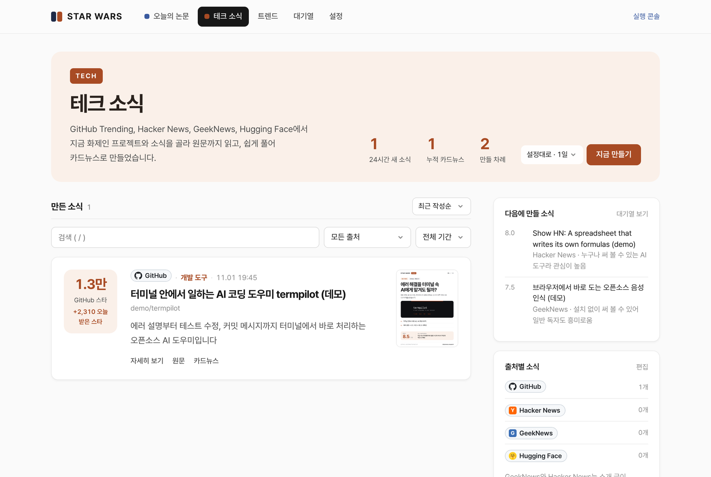

- **소식 카드:** 출처 배지(GitHub · Hacker News · GeekNews · Hugging Face), 분야, 핵심 숫자(GitHub 스타, 추천 수 등)를 보여 줍니다. 만든 회사(Meta, Apple, Google 등)가 확인되면 **공식 로고**도 붙습니다.
- **찾기와 정렬:** 검색, 출처, 기간으로 거르고 최근 작성순 · 흥미도순으로 정렬합니다.
- **오른쪽 패널:** 다음에 만들 소식과 출처별 소식 수가 있습니다.
- **지금 만들기:** 관리자는 이번에 모을 기간(오늘 · 3일 · 일주일 · 2주 · 한 달)을 골라 바로 만들 수 있습니다.

### 5. 테크 소식 상세

소식 하나를 누르면 설명 전체를 볼 수 있습니다.

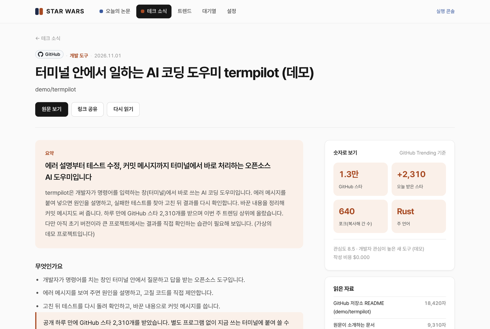

- **설명:** 요약 · 무엇인가요 · 어떻게 작동하나요 · 그래서 나랑 무슨 상관? · 직접 써보기 · 알아 둘 점 · 용어 정리 순서입니다.
- **원문까지 읽고 씁니다.** 뉴스 사이트의 짧은 소개 대신, 소개 글이 가리키는 원문을 끝까지 읽습니다.
  - 기사가 소개하는 **GitHub 저장소**도 따라가 읽습니다.
  - arXiv 링크는 **논문 전문과 그림**을, PDF 링크는 PDF를 읽습니다.
  - 접속을 막는 사이트나 JavaScript로 그리는 페이지도 브라우저로 열어 읽습니다.
- **숫자로 보기:** 스타 수, 오늘 받은 스타, 추천 수, 댓글 수처럼 출처가 공개한 숫자를 보여 줍니다.
- **읽은 자료:** 무엇을 몇 자 읽고 썼는지 나옵니다(관리자에게만 보임). 원문을 끝내 읽지 못하면 제목만으로 만들지 않고 이유를 남깁니다.
- **버튼:** 원문 보기, GitHub 저장소, 출처의 토론 페이지(Hacker News 등), 링크 공유, **다시 읽기**가 있습니다.

### 6. 트렌드

지금 연구자들 사이에서 화제인 논문을 모은 화면입니다. 공개 데이터만 쓰므로 Claude API가 없어도 실행할 때마다 갱신됩니다.

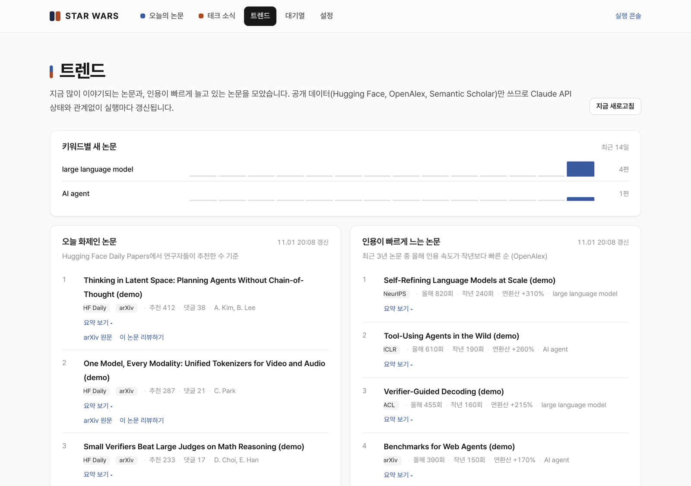

| 패널 | 내용 | 데이터 |
|---|---|---|
| **키워드별 새 논문** | 최근 14일 동안 키워드마다 모인 논문 수 (막대) | 이 대시보드 |
| **오늘 화제인 논문** | 연구자들이 추천을 많이 한 오늘의 논문 | Hugging Face Daily Papers |
| **인용이 빠르게 느는 논문** | 최근 3년 논문 중 올해 인용 속도가 작년보다 빠른 순 | OpenAlex |
| **많이 인용된 최근 논문** | 최근 1년, 관심 키워드별 누적 인용 순 | OpenAlex |
| **리뷰한 논문의 인용 변화** | 지난 7일 동안 늘어난 인용 수 | Semantic Scholar |

- 항목마다 **요약 보기**로 초록을 펼칠 수 있습니다.
- 관리자는 **이 논문 리뷰하기**로 화제인 논문을 바로 리뷰에 넣을 수 있습니다.

### 7. 대기열

다음 실행에서 무엇을 읽고 만들지 미리 보고 고르는 화면입니다. 위쪽 **논문 | 테크 소식** 스위치로 오갑니다.

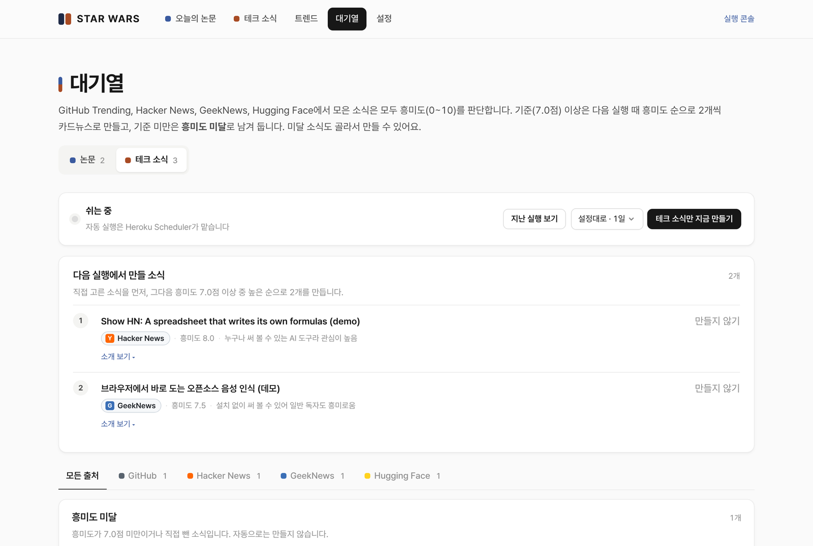

- **다음 실행에서 읽을 논문(만들 소식):** 직접 고른 항목이 먼저 오고, 그다음 점수가 높은 순서입니다. 실행 중에는 진행 상황이 함께 표시됩니다.
- **점수 미달:** 기준보다 낮은 항목도 버리지 않고 남겨 둡니다. **초록 보기**(테크는 **소개 보기**)로 내용을 확인할 수 있습니다.
- **관리자가 할 수 있는 일:**
  - 고른 항목을 **지금 읽기**
  - **다음 실행 때 먼저 읽기**로 순서를 앞당기기
  - **읽지 않기**(테크는 **만들지 않기**)로 빼기
- **출처별 탭:** 출처마다 대기 중인 항목만 볼 수 있습니다.

### 8. 설정 (관리자)

에이전트가 무엇을, 얼마나 자주 읽을지 정하는 화면입니다.

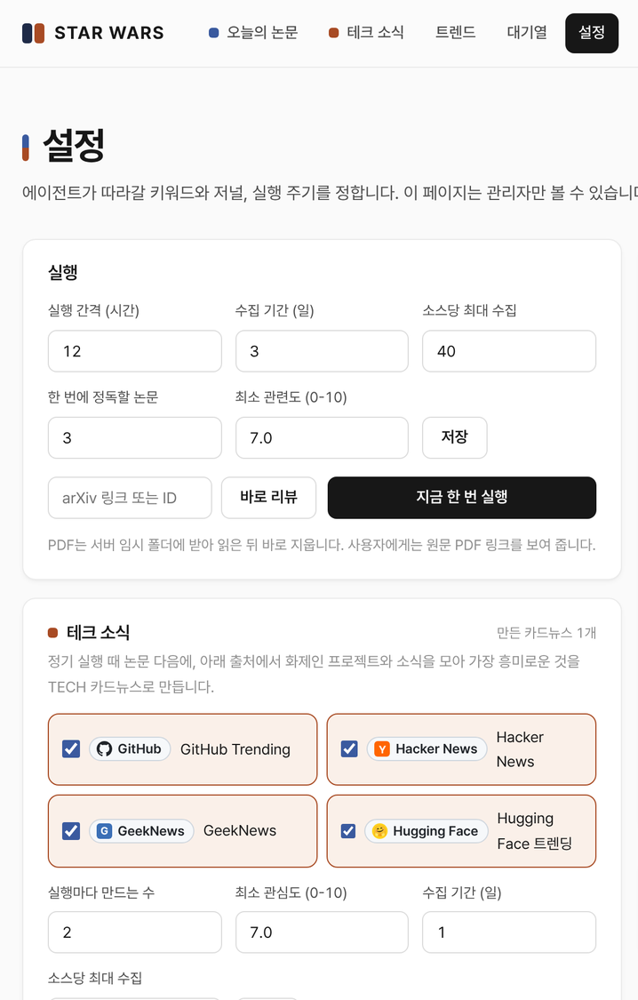

- **실행:**
  - 실행 간격, 수집 기간(며칠 전 논문까지 모을지), 소스당 최대 수집, 한 번에 정독할 논문 수, 최소 관련도
  - **arXiv 링크 또는 ID로 바로 리뷰**
  - **지금 한 번 실행**
- **테크 소식:** 사용할 출처, 실행마다 만드는 수, 최소 흥미도, 수집 기간(1 = 오늘, 7 = 일주일, 최대 30), 소스당 최대 수집
- **관심 키워드:** 제목이나 초록에 이 단어가 들어간 논문을 모읍니다. 에이전트가 관련도를 다시 판단하므로 넓게 적어도 됩니다.
- **논문 출처:** arXiv 분야와 저널 · 학회를 검색해서 추가합니다. 출처마다 모인 논문 수가 보입니다.
- **PDF로 논문 추가:** 가지고 있는 논문 PDF를 올리면 점수와 상관없이 끝까지 읽고 리뷰와 카드뉴스를 만듭니다.
- **모델과 비용 · 실행 기록:** 최근 30일 비용, 논문당 평균 비용, 실행별 결과를 볼 수 있습니다.

> [!TIP]
> 위쪽의 **실행 콘솔**을 누르면 지금 무엇을 하고 있는지(수집 → 관련도 판단 → 정독·리뷰 → 트렌드 → 테크 소식)와 실행 로그를 실시간으로 볼 수 있습니다. 실행 중에는 그 자리에서 **강제 종료**도 할 수 있습니다.

---

## 🧠 어떻게 읽고 평가하나요

세 가지 Claude 모델이 일을 나눠 맡습니다. 가장 긴 글(PDF 전문)은 가장 저렴한 모델이 읽고, 점수는 가장 좋은 모델이 매깁니다.

```
논문   모으기 ─▶ 관련도 판단 ─▶ PDF 정독 ─▶ 평가 ─▶ 리뷰 작성 ─▶ PAPER 카드뉴스
                 (Haiku)        (Haiku)     (Opus)   (Sonnet)

테크   모으기 ─▶ 흥미도 판단 ─▶ 원문 · 저장소 · 논문 읽기 ─▶ 설명 작성 ─▶ TECH 카드뉴스
                 (Haiku)                                     (Sonnet)
```

- **근거 기반 평가:** 정독 모델이 PDF에서 근거를 뽑아 노트로 남기고, 평가 모델은 그 노트만 보고 방법론과 참신성을 채점합니다.
- **지어내지 않기:** 리뷰와 설명은 읽은 자료에 있는 사실과 숫자만 씁니다. 모르는 내용은 빼고, 어려운 용어는 따로 풀이합니다.
- **멈추지 않기:** Claude API에 문제가 생기면 AI 단계만 쉬고, 논문 수집 · 트렌드 · 기존 리뷰와 카드뉴스는 그대로 동작합니다.

기본 설정으로 논문 한 편에 약 **$0.15~0.22**, 하루 약 **$1~1.4**, 테크 소식 한 개에 약 **$0.05~0.15**가 듭니다. 실제로 쓴 비용은 **설정 → 모델과 비용**에서 볼 수 있습니다.

---

## 🚀 시작하기

API 키가 없어도 데모 데이터로 모든 화면을 둘러볼 수 있습니다. Python 3.10 이상이 필요합니다.

```bash
git clone https://github.com/SeonGyuJang/STAR_WARS.git && cd STAR_WARS
python3 -m venv .venv && source .venv/bin/activate   # Windows: .venv\Scripts\Activate.ps1
pip install -r requirements.txt
python -m playwright install chromium
cp .env.example .env

python -m paperagent demo        # 가상 논문 1편과 테크 소식 1개 넣기
python -m paperagent serve --host 127.0.0.1 --port 8000 --no-scheduler
```

브라우저에서 http://127.0.0.1:8000 을 엽니다.

**실제로 써 보려면**

1. `.env`에 Claude API 키를 넣습니다: `ANTHROPIC_API_KEY=sk-ant-...` (발급 방법은 [처음 설정](docs/SETUP.md#2-anthropic-api-키와-비용)에 있습니다)
2. **설정**에서 관심 키워드와 arXiv 분야 · 저널 · 학회를 등록합니다.
3. **지금 한 번 실행**을 누르고, 위쪽 **실행 콘솔**에서 진행 상황을 봅니다.

논문 하나만 먼저 시험해 보고 싶다면 설정의 **바로 리뷰** 칸에 arXiv 링크를 넣거나 `python -m paperagent review 1706.03762`를 실행하세요.

> 서버에 올려 계속 돌리는 방법(Heroku 배포, 환경 변수, 명령어 전체)은 [사용 설명서](docs/USAGE.md)와 [처음 설정](docs/SETUP.md)에 정리했습니다.

---

## ❓ 자주 묻는 질문

<details>
<summary><b>평점과 리뷰는 믿을 만한가요?</b></summary>

에이전트가 원문을 끝까지 읽고 근거를 남긴 뒤 평가하지만, AI가 쓴 글이라 틀릴 수 있습니다. 리뷰는 읽을 논문을 고르고 핵심을 빠르게 파악하는 데 쓰고, 중요한 판단 전에는 원문을 확인하세요.
</details>

<details>
<summary><b>관련도가 낮다고 빠진 논문도 볼 수 있나요?</b></summary>

네. **대기열**의 관련도 미달 목록에 그대로 남아 있습니다. 관리자는 골라서 **지금 읽기**를 누르면 됩니다.
</details>

<details>
<summary><b>테크 소식을 일주일치 모을 수 있나요?</b></summary>

**설정 → 테크 소식 → 수집 기간**을 7로 바꾸면 됩니다. 한 번만 바꾸고 싶으면 테크 소식이나 대기열 화면의 **지금 만들기** 옆에서 기간을 고르세요. 이미 모은 소식은 다시 모으지 않습니다.
</details>

<details>
<summary><b>테크 소식이 "원문을 읽지 못해 쓸 내용이 없습니다"로 멈췄어요.</b></summary>

원문 사이트가 접속을 막았거나 내려가 있었던 경우입니다. 빈 카드뉴스를 만들지 않으려고 멈춘 것이니, 시간이 지난 뒤 소식 페이지에서 **다시 읽기**를 누르세요.
</details>

<details>
<summary><b>카드뉴스를 인스타그램에 어떻게 올리나요?</b></summary>

카드뉴스 칸의 **전체 받기 (ZIP)** 로 받은 파일을 번호 순서대로 한 게시물에 올리고, **캡션 복사**로 캡션을 붙여 넣으면 됩니다. 마지막 장은 영상(MP4)이고, 사진과 영상은 한 게시물에 섞어 올릴 수 있습니다.
</details>

<details>
<summary><b>API 키 없이 어디까지 쓸 수 있나요?</b></summary>

논문 수집, 트렌드, 대시보드, 데모 데이터, 이미 만든 리뷰와 카드뉴스는 모두 동작합니다. 관련도 판단 · 정독 · 평가 · 작성 같은 AI 단계만 멈춥니다.
</details>

더 많은 문제 해결 방법은 [처음 설정 · 문제 해결](docs/SETUP.md#6-문제-해결)에 있습니다.

---

## 🙏 감사의 말

- 논문 데이터: [arXiv](https://arxiv.org), [OpenAlex](https://openalex.org), [Semantic Scholar](https://www.semanticscholar.org), [Hugging Face Daily Papers](https://huggingface.co/papers). *Thank you to arXiv for use of its open access interoperability.*
- 테크 소식: [GitHub Trending](https://github.com/trending), [Hacker News](https://news.ycombinator.com), [GeekNews](https://news.hada.io), [Hugging Face](https://huggingface.co)
- 회사 로고: [Simple Icons](https://simpleicons.org) (CC0). 로고는 누가 만든 프로젝트인지 알리는 용도로만 쓰며, 상표권은 각 회사에 있습니다.
- 글꼴: [Pretendard](https://github.com/orioncactus/pretendard), [JetBrains Mono](https://www.jetbrains.com/lp/mono/) (SIL Open Font License 1.1)

<div align="center">
<br>
<sub>요약과 평점은 에이전트가 원문을 읽고 자동으로 작성합니다. 틀릴 수 있으니 중요한 판단 전에는 원문을 확인하세요.</sub>
</div>
