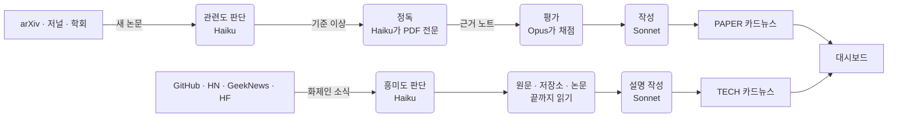

<div align="center">

# STAR WARS

**S**mart **T**opic **A**nalysis & **R**ating : **W**orthwise **A**rticle **R**esearch **S**ystem

**읽을 가치가 있는 논문만 골라 끝까지 읽고, 평가하고, 카드뉴스로 만드는 Claude 에이전트**<br>
지금 개발자들이 주목하는 기술 소식도 원문까지 읽고 쉽게 풀어 줍니다.


[빠른 시작](#-빠른-시작) ·
[주요 기능](#-주요-기능) ·
[작동 방식](#-작동-방식) ·
[사용 설명서](docs/USAGE.md) ·
[처음 설정](docs/SETUP.md) ·
[FAQ](#-자주-묻는-질문)


<sub>위 카드뉴스와 아래 화면은 모두 데모용 가상 논문·가상 프로젝트로 만든 예시입니다. 남색은 논문(PAPER), 테라코타색은 테크 소식(TECH)입니다.</sub>

</div>

---

## 📢 업데이트

- **2026.11** 테크 소식도 논문처럼 **수집 기간**(오늘 · 일주일 · 최대 30일)을 정할 수 있습니다. 실행할 때 이번 한 번만 바꿀 수도 있습니다.
- **2026.10** Hacker News · GeekNews 소식은 소개 글이 아니라 **원문을 끝까지 읽고** 씁니다. 기사, PDF, arXiv 논문 전문과 그림, GitHub 저장소까지 따라가 읽습니다. 원문을 읽지 못하면 제목만으로 만들지 않고 보류합니다.
- **2026.10** 카드뉴스 표지를 바꿨습니다. 그림과 핵심 요점 3줄을 넣고, 그림이 없으면 핵심 수치를 크게 보여 줍니다. 테크 표지에는 흥미도와 AI 한줄평이 들어갑니다. 대시보드에서 카드뉴스를 **전체 화면**으로 볼 수 있습니다.
- **2026.10** **TECH 카테고리**가 생겼습니다. GitHub Trending, Hacker News, GeekNews, Hugging Face에서 화제인 소식을 골라 카드뉴스로 만듭니다. 마지막 장은 글자가 움직이는 **MP4 영상**입니다.
- **2026.10** arXiv가 요청을 막을 때(HTTP 429)는 기다렸다 다시 묻고, 그래도 안 되면 RSS 피드로 그날 논문을 가져옵니다.

## ✨ 주요 기능

### 1. 읽을 가치가 있는 논문만, 끝까지 읽고 평가

관심 키워드와 arXiv 분야, 저널·학회(NeurIPS, CVPR 등)를 등록하면 12시간마다 새 논문을 모읍니다. 모은 논문은 모두 관련도(0~10점)를 매기고, 기준 이상인 논문만 **PDF 전문**을 읽습니다. 그다음 **방법론 신뢰도**와 **참신성**으로 채점하고 한국어 리뷰를 씁니다.

- **세 모델 분업:** 저렴한 Haiku가 PDF를 읽어 근거 노트를 만들고, Opus는 그 노트만 보고 점수를 매기고, Sonnet이 문장을 씁니다.
- **근거가 남는 리뷰:** 요약, 기존 연구와 다른 점, 한계, 추천 독자, 용어 정리를 함께 보여 줍니다. 모든 판단은 노트에 적힌 근거에서 나옵니다.


### 2. 바로 올릴 수 있는 카드뉴스

리뷰마다 인스타그램 규격(1080×1350) 카드뉴스와 캡션을 만듭니다. 질문형 표지로 시작해 **그래서 나랑 무슨 상관?**으로 의미를 짚고, 평가와 정리로 끝납니다.

<table>
<tr>
<td width="62%"></td>
<td width="38%" align="center"></td>
</tr>
<tr>
<td align="center"><sub>대시보드에서 전체 화면으로 넘겨 보기 (← → · 스와이프 · Esc)</sub></td>
<td align="center"><sub>마지막 장은 매번 같은 효과의 MP4 영상</sub></td>
</tr>
</table>

- **전체 받기**를 누르면 카드 이미지, 마지막 장 영상, `caption.txt`가 든 ZIP을 받습니다. 파일 번호 순서대로 올리면 됩니다.
- 그림은 논문 PDF에서 뽑습니다. 그림이 각주나 본문과 겹치지 않도록 크기를 자동으로 맞춥니다.

### 3. 테크 소식: 소개 글이 아니라 원문을 읽습니다

GitHub Trending, Hacker News, GeekNews, Hugging Face에서 화제인 프로젝트와 소식을 모아 흥미도를 매기고, 가장 흥미로운 것을 쉬운 한국어 설명과 TECH 카드뉴스로 만듭니다.

- **원문까지 따라가 읽기:** 뉴스 사이트 → 원문 기사 → 그 기사가 소개하는 GitHub 저장소까지 읽습니다. arXiv 링크는 논문 전문과 그림을, PDF 링크는 PDF를 읽습니다.
- **막힌 페이지 대처:** 봇을 막는 사이트는 브라우저처럼 요청하고, JavaScript로 그리는 페이지는 헤드리스 Chromium으로 엽니다.
- **읽은 자료 확인:** 무엇을 몇 자 읽었는지 소식 페이지의 **읽은 자료**에 남습니다. 원문을 끝내 읽지 못하면 이유를 남기고 만들지 않으니, 나중에 **다시 읽기**를 누르면 됩니다.
- **회사 로고와 데모 영상:** 만든 회사(Meta, Apple, Google 등)가 확인되면 공식 로고를 넣습니다. 원본에 있는 데모 영상은 소개 내용과 맞을 때만 카드에 씁니다.


### 4. 대기열: 다음에 무엇을 읽을지 보고 고르기

다음 실행에서 읽을 논문과 만들 테크 소식이 순서대로 보입니다. **논문 | 테크 소식**을 오가며 순서를 바꾸거나, 점수 미달 항목을 골라 바로 만들 수 있습니다. 테크 소식은 **지금 만들기** 옆에서 이번에 모을 기간(오늘 · 일주일 · 한 달 등)을 고를 수 있습니다.


### 5. 트렌드와 대시보드

오늘 화제인 논문(Hugging Face Daily Papers)과 인용이 빠르게 느는 논문(OpenAlex, Semantic Scholar)을 모읍니다. 공개 데이터만 쓰므로 **Claude API 없이도** 갱신됩니다. 대시보드는 누구나 볼 수 있고, 설정과 실행은 관리자만 할 수 있습니다.

<table>
<tr>
<td width="50%"></td>
<td width="50%"></td>
</tr>
<tr>
<td align="center"><sub>오늘의 논문</sub></td>
<td align="center"><sub>테크 소식</sub></td>
</tr>
</table>

> [!NOTE]
> **Claude API에 문제가 생겨도 멈추지 않습니다.** API 키가 없거나 크레딧이 부족하면 AI 단계만 건너뛰고, 논문 수집·트렌드·기존 리뷰와 카드뉴스는 그대로 동작합니다. 키를 고친 뒤 **API 다시 확인**을 누르면 이어서 읽습니다.

## 🔍 작동 방식



| 단계 | 모델 | 하는 일 |
|---|---|---|
| 관련도 · 흥미도 판단 | Haiku | 제목과 초록(소개)만 보고 0~10점 |
| 정독 | Haiku | 입력이 가장 큰 PDF 전문을 읽고 근거 노트 작성 |
| 평가 | Opus | 노트만 읽고 방법론 신뢰도 · 참신성 채점 |
| 작성 | Sonnet | 한국어 리뷰, 카드뉴스 문구, 캡션 |

기본 설정으로 논문 한 편에 약 **$0.15~0.22**, 하루 약 **$1~1.4**, 테크 소식 한 개에 약 **$0.05~0.15**가 듭니다. 실제 비용은 **설정 → 모델과 비용**에서 볼 수 있습니다. 자세한 표는 [SETUP.md 2장](docs/SETUP.md#2-anthropic-api-키와-비용)에 있습니다.

## 🚀 빠른 시작

API 키 없이도 데모 데이터로 모든 화면을 볼 수 있습니다.

```bash
git clone https://github.com/SeonGyuJang/STAR_WARS.git && cd STAR_WARS
python3 -m venv .venv && source .venv/bin/activate   # Windows: .venv\Scripts\Activate.ps1
pip install -r requirements.txt
python -m playwright install chromium                 # 카드뉴스를 찍는 브라우저 (한 번만)
cp .env.example .env

python -m paperagent demo                             # 가상 논문 1편 + 테크 소식 1개
python -m paperagent serve --host 127.0.0.1 --port 8000 --no-scheduler
```

http://127.0.0.1:8000 을 열면 됩니다. 실제 논문을 읽히려면 `.env`에 `ANTHROPIC_API_KEY`를 넣고 화면의 **지금 실행**을 누르거나, 논문 하나를 바로 리뷰해 보세요.

```bash
python -m paperagent review 1706.03762    # "Attention Is All You Need" (1~3분)
python -m paperagent run                  # 수집부터 카드뉴스까지 한 번 실행
```

단계별 설명, 전체 명령어, 테스트 방법은 **[사용 설명서](docs/USAGE.md)**에 있습니다.

### Heroku에 배포

Postgres와 Scheduler 애드온, Chromium 빌드팩으로 동작합니다. 처음 한 번 하는 설정(앱 · 빌드팩 · 애드온 · 환경 변수 · 스케줄러)은 [SETUP.md 4장](docs/SETUP.md#4-heroku-첫-배포)에, 이후 변경 사항을 올리는 방법은 [사용 설명서 5장](docs/USAGE.md#5-heroku에-변경-사항-올리기)에 있습니다.

```bash
git push heroku main                     # 배포
heroku run python -m paperagent demo     # 데모 데이터로 확인
```

## ⚙️ 주요 설정

대부분의 값은 대시보드 **설정** 화면에서 바꿉니다. 환경 변수 전체 목록은 [SETUP.md 3장](docs/SETUP.md#3-환경-변수-전체-목록)에 있습니다.

| 구분 | 설정 | 기본값 | 설명 |
|---|---|---|---|
| 논문 | 실행 간격 | 12시간 | 자동 실행 주기 |
| | 수집 기간 | 3일 | 며칠 전 논문까지 모을지 |
| | 한 번에 정독할 논문 | 3편 | 실행마다 PDF 전문을 읽는 수 |
| | 최소 관련도 | 7.0 | 이보다 낮으면 대기열의 관련도 미달로 남김 |
| 테크 | 수집 기간 | 1일 | 1 = 오늘, 7 = 일주일, 최대 30 |
| | 실행마다 만드는 수 | 2개 | 0이면 정기 실행에서 만들지 않음 |
| | 최소 흥미도 | 7.0 | 이보다 낮으면 흥미도 미달로 남김 |
| 공통 | `CARD_HANDLE` | `@starwars.research` | 카드뉴스에 찍히는 계정 |

## ❓ 자주 묻는 질문

<details>
<summary><b>로그에 <code>arXiv ... 429</code>가 나옵니다</b></summary>

arXiv는 같은 서버에서 요청이 몰리면 잠시 막습니다(Heroku는 여러 앱이 IP를 함께 써서 더 자주 생깁니다). 한 번 실행에 arXiv 분야 전체를 요청 1번으로 묻고, 막히면 arXiv가 알려 준 시간만큼 기다렸다 다시 묻습니다. 그래도 안 되면 RSS 피드로 그날 논문을 가져오므로 따로 할 일은 없습니다.
</details>

<details>
<summary><b>테크 소식이 <code>원문을 읽지 못해 쓸 내용이 없습니다</code>로 멈췄습니다</b></summary>

원문 사이트가 접속을 막았거나 내려가 있었던 경우입니다. 빈 카드뉴스를 만들지 않으려고 멈춘 것이니, 시간이 지난 뒤 소식 페이지에서 **다시 읽기**를 누르세요. 괄호 안에 `HTTP 403 (사이트)`처럼 이유가 나옵니다.
</details>

<details>
<summary><b>마지막 장이 영상이 아니라 그림으로 나옵니다</b></summary>

영상은 ffmpeg로 만듭니다. 시스템에 ffmpeg가 없으면 `requirements.txt`의 `imageio-ffmpeg`에 들어 있는 것을 씁니다. 둘 다 없거나 `VIDEO_CARDS=0`이면 그림 카드로 대신합니다.
</details>

<details>
<summary><b>API 키 없이 어디까지 쓸 수 있나요?</b></summary>

논문 수집, 트렌드, 대시보드, 데모 데이터, 이미 만든 리뷰와 카드뉴스는 모두 동작합니다. 관련도 판단·정독·평가·작성 같은 AI 단계만 멈춥니다.
</details>

<details>
<summary><b>카드뉴스의 회사 로고는 써도 되나요?</b></summary>

[Simple Icons](https://simpleicons.org)(CC0)의 공식 브랜드 마크를 씁니다. 누가 만든 프로젝트인지 알리는 용도로만 쓰며, 상표권은 각 회사에 있습니다. Simple Icons에 없는 회사(예: OpenAI, Microsoft)는 로고 없이 이름만 표시합니다.
</details>

더 많은 문제 해결 방법은 [SETUP.md 6장](docs/SETUP.md#6-문제-해결)에 있습니다.

<details>
<summary><b>📁 프로젝트 구조</b></summary>

```
STAR_WARS/
├── paperagent/
│   ├── collectors/        arXiv · 저널·학회 · OpenAlex · 트렌드 · 테크 소식(tech.py) 수집
│   ├── agent.py           Claude 호출 (관련도 · 정독 · 평가 · 작성 · 테크 설명)과 비용 계산
│   ├── pipeline.py        한 번의 실행: 수집 → 판단 → 리뷰 → 카드뉴스 → 트렌드 → 테크 소식
│   ├── technews.py        테크 소식: 원문 읽기 → 그림·영상 → 작성 → 카드뉴스
│   ├── cardnews.py        카드뉴스 렌더링 (Chromium)
│   ├── video.py           마지막 장 영상 · 데모 영상 (ffmpeg)
│   ├── logos.py           회사 로고 (Simple Icons)
│   ├── pdfs.py            PDF 임시 다운로드, 그림 추출
│   ├── db.py · storage.py DB와 파일 저장 (로컬 SQLite / Heroku Postgres)
│   ├── web.py             대시보드
│   ├── templates/         대시보드와 카드뉴스 HTML (cards/cards.html)
│   └── static/            CSS · JS · 글꼴 · 로고
├── tests/                 pytest (SQLite · Postgres)
├── docs/                  USAGE.md(사용 설명서) · SETUP.md(처음 설정) · images/
└── Procfile · app.json · requirements.txt · .env.example
```
</details>

## 🙏 감사의 말

- 논문 메타데이터: [arXiv](https://arxiv.org), [OpenAlex](https://openalex.org), [Semantic Scholar](https://www.semanticscholar.org), [Hugging Face Daily Papers](https://huggingface.co/papers). *Thank you to arXiv for use of its open access interoperability.*
- 테크 소식: [GitHub Trending](https://github.com/trending), [Hacker News](https://news.ycombinator.com) ([HN Search API](https://hn.algolia.com/api)), [GeekNews](https://news.hada.io), [Hugging Face](https://huggingface.co)
- 브랜드 마크: [Simple Icons](https://simpleicons.org) (CC0 1.0)
- 글꼴: [Pretendard](https://github.com/orioncactus/pretendard), [JetBrains Mono](https://www.jetbrains.com/lp/mono/) (SIL Open Font License 1.1)
- 렌더링: [Playwright](https://playwright.dev), [FFmpeg](https://ffmpeg.org)

## 📝 인용

연구나 발표에서 이 프로젝트를 언급할 때는 아래 형식을 쓸 수 있습니다.

```bibtex
@software{star_wars_2026,
  title  = {STAR WARS: Smart Topic Analysis \& Rating -- Worthwise Article Research System},
  author = {Jang, SeonGyu},
  year   = {2026},
  url    = {https://github.com/SeonGyuJang/STAR_WARS}
}
```

---

<div align="center">
<sub>요약과 평점은 에이전트가 원문을 읽고 자동으로 작성합니다. 틀릴 수 있으니 중요한 판단 전에는 원문을 확인하세요.</sub>
</div>
