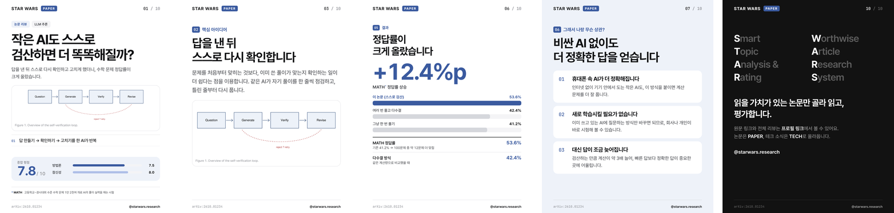
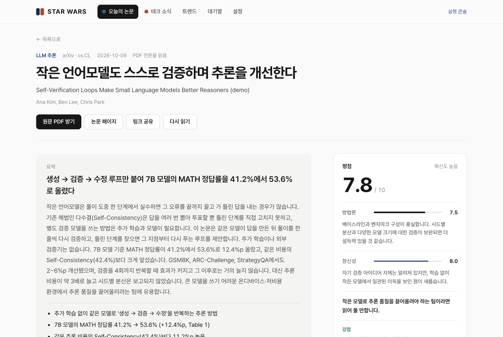
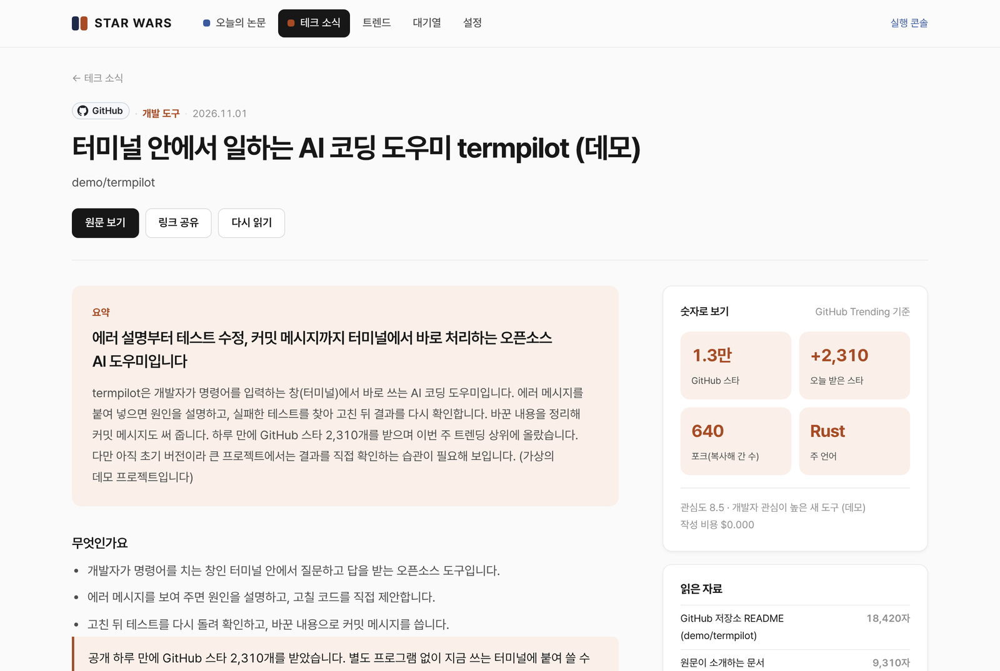
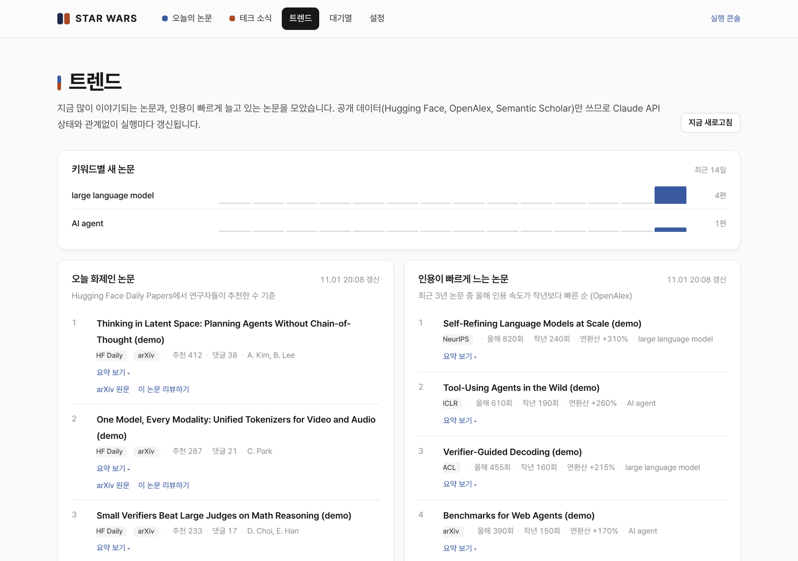

# STAR WARS

**S**mart **T**opic **A**nalysis & **R**ating : **W**orthwise **A**rticle **R**esearch **S**ystem

매일 쏟아지는 AI 논문과 기술 소식 중 읽을 가치가 있는 것만 골라 끝까지 읽고, 평가하고, 인스타그램 카드뉴스로 만들어 주는 AI 연구 비서입니다.



## 1. 목적과 사용자

최신 AI 논문은 하루에도 수백 편씩 나옵니다. 제목과 초록만으로는 읽을 가치가 있는지 판단하기 어렵고, 다 읽기에는 시간이 부족합니다.

STAR WARS는 관심 키워드에 맞는 논문을 모아 관련도를 매기고, 기준을 넘는 논문만 PDF 전문을 읽은 뒤 방법론과 참신성으로 평가합니다. 결과는 한국어 리뷰와 카드뉴스로 정리됩니다. GitHub Trending, Hacker News, GeekNews, Hugging Face의 기술 소식도 원문까지 읽고 쉽게 풀어 줍니다.

**사용자**

- 최신 연구를 따라가야 하는 대학원생과 연구자
- 기술 소식을 쉽게 풀어 전하는 콘텐츠 운영자. 실제로 이 도구로 만든 카드뉴스로 인스타그램 계정을 운영했습니다.

## 2. 실행 방법

Python 3.10 이상이 필요합니다. API 키가 없어도 데모 데이터로 모든 화면을 볼 수 있습니다.

```bash
git clone https://github.com/SeonGyuJang/STAR_WARS.git && cd STAR_WARS
python3 -m venv .venv && source .venv/bin/activate
pip install -r requirements.txt
python -m playwright install chromium
cp .env.example .env
python -m paperagent demo
python -m paperagent serve --host 127.0.0.1 --port 8000 --no-scheduler
```

http://127.0.0.1:8000 을 엽니다. 실제로 쓰려면 다음 순서를 따릅니다.

1. `.env`에 `ANTHROPIC_API_KEY`를 넣습니다.
2. **설정**에서 관심 키워드와 arXiv 분야, 저널, 학회를 등록합니다.
3. **지금 한 번 실행**을 누릅니다. 진행 상황은 위쪽 **실행 콘솔**에서 볼 수 있습니다.

| 화면 | 할 수 있는 일 |
|---|---|
| 오늘의 논문 | 평점과 함께 쌓인 논문을 검색하고 출처·키워드·기간으로 거르기 |
| 논문 리뷰 | 리뷰 전문과 점수 이유 보기, 카드뉴스 넘겨 보기·ZIP 받기·캡션 복사 |
| 테크 소식 | 원문까지 읽고 쓴 설명과 **읽은 자료** 보기 |
| 트렌드 | 오늘 화제인 논문, 인용이 빠르게 느는 논문 보기 |
| 대기열 | 다음에 읽을 논문과 만들 소식의 순서 바꾸기, 테크 수집 기간 고르기 |

Heroku 배포와 환경 변수는 [docs/SETUP.md](docs/SETUP.md), 명령어 전체는 [docs/USAGE.md](docs/USAGE.md)에 있습니다.



## 3. 작업 과정

10월 11일부터 Claude Code와 대화하며 **작게 만들고, 직접 써 보고, 고치는 과정**을 반복했습니다. 커밋은 40개가 넘습니다.

1. **논문 파이프라인:** 수집 → 관련도 판단 → PDF 정독 → 평가 → 작성 순서를 먼저 만들었습니다. 핵심 결정은 모델 세 개의 분업입니다. 가장 긴 PDF는 저렴한 Haiku가 읽고 근거 노트를 만들고, Opus는 그 노트만 보고 채점하고, Sonnet이 한국어로 씁니다. 논문 한 편에 약 $0.15~0.22가 듭니다.
2. **카드뉴스와 대시보드:** Chromium으로 카드를 그리고, 마지막 장은 ffmpeg로 영상을 만들었습니다.
3. **범위 조정:** 인스타그램 자동 업로드를 만들었다가, 계정 정책과 품질 관리 문제로 빼고 업로드 재료만 준비하게 바꿨습니다. 대신 일반 독자를 위한 TECH 카테고리를 추가했습니다.
4. **배포 후 개선:** Heroku에서 실제로 돌리며 나온 오류와 결과물의 문제를 하나씩 고쳤습니다.

## 4. Claude Code 작업 증거와 검증

**증거 1. 실제 로그를 그대로 전달**

> `[15:01:43] arXiv cs.AI failed: 429 from https://export.arxiv.org/api/query` … 실행을 하면 이 오류가 나는데, 전반적으로 모든 기능에서 오류가 없는지 점검해

Claude Code는 원인을 "카테고리마다 요청을 따로 보낸 것"으로 찾았습니다. 그래서 요청을 하나로 합치고, arXiv가 알려 준 시간만큼 기다렸다 다시 묻고, 그래도 막히면 RSS로 대신 가져오게 고쳤습니다(`paperagent/collectors/arxiv.py`).

**증거 2. 결과물을 보고 문제 지적**

> 지금 카드뉴스랑 정리본에는 해커뉴스에서 다뤄진 내용만 있어서 아무 내용도 담지 못한 채 카드뉴스가 만들어지고 있어.

이후 테크 소식은 소개 글이 가리키는 원문 기사, GitHub 저장소, arXiv 논문 전문까지 따라가 읽습니다. 원문을 못 읽으면 빈 카드뉴스를 만들지 않고 이유를 남깁니다.



**검증 결과**

- **자동 테스트:** 119개가 SQLite와 Postgres(배포 환경과 같은 DB)에서 모두 통과합니다.
  ```bash
  python -m pytest -q tests        # 119 passed
  ```
- **버그 재현 테스트:** 버그가 날 때마다 그 상황을 재현하는 테스트를 먼저 만들었습니다. 예를 들어 `tests/test_tech.py`의 `test_the_failing_run_again`은 실제로 실패했던 실행 로그 4건을 그대로 재현합니다.
- **화면 점검:** 브라우저로 모든 페이지를 데스크톱(1280px)과 모바일(390px) 폭에서 열었고, 오류 응답·JS 오류·가로 스크롤은 0건이었습니다. 관리자 폼 46개를 모두 제출해 서버 오류가 없는지도 확인했습니다.
- **엣지 케이스:** 원문 사이트가 접속을 막으면(HTTP 403) 카드뉴스를 만들지 않고, `원문을 읽지 못해 쓸 내용이 없습니다 (… HTTP 403 …)`라는 이유와 함께 보류합니다(`test_no_hollow_post_when_the_original_cannot_be_read`).
- **장애 상황:** Claude API 키가 없거나 크레딧이 부족해도 AI 단계만 건너뛰고, 수집·트렌드·기존 리뷰는 그대로 동작합니다.

## 5. 도움이 된 방법 3가지

1. **설명 대신 증거를 줬습니다.** "오류가 나요" 대신 실제 로그와 스크린샷을 붙여 넣었더니, 원인을 한 번에 찾는 경우가 많았습니다.
2. **선택지는 Claude가 내고, 결정은 제가 했습니다.** 디자인처럼 정답이 없는 부분은 추천안과 선택지를 먼저 받았습니다. 예를 들어 카드뉴스 첫 장은 "핵심 숫자 + 요점 3줄" 안을 골랐고, 그 덕분에 다시 만드는 일이 줄었습니다.
3. **"다 됐다"는 말보다 검증을 요구했습니다.** 매번 테스트와 실제 화면으로 확인하게 하고, 확인하지 못한 부분은 따로 말해 달라고 했습니다.

## 6. 어려웠던 점 3가지

1. **"AI가 만든 티"가 나는 디자인**
   - 문제: 처음 카드뉴스는 색이 너무 쨍하고 장식이 많았습니다.
   - 대응: 여러 번 고친 끝에 예전 흰 배경 디자인으로 돌아가 시각 효과만 다듬었습니다.
   - 남은 문제: 디자인은 주관적인 영역이라 계속 다듬고 있습니다.
2. **외부 사이트의 차단**
   - 문제: arXiv는 429, GeekNews는 403으로 요청을 막았습니다. 개발 환경에서는 이런 사이트에 직접 접속할 수 없어서, 실제와 같은 형태의 가짜 응답으로 테스트했습니다.
   - 대응: 재시도, RSS 대체, 헤드리스 브라우저로 다시 열기를 넣었습니다.
   - 남은 문제: 사이트 구조가 바뀌면 다시 고쳐야 합니다.
3. **재현되지 않는 오류**
   - 문제: 배포 서버에서만 HTML 분석 라이브러리(soupsieve)가 오류를 냈고, 여러 Python 버전에서도 재현되지 않았습니다.
   - 대응: 그 라이브러리를 쓰지 않는 방식으로 바꿔 우회하고, 라이브러리가 고장 나도 동작하는지 테스트로 확인했습니다.
   - 남은 문제: 근본 원인은 아직 확인하지 못했습니다.

## 7. 알려진 한계

- 리뷰와 평점은 AI가 쓴 것이라 틀릴 수 있습니다. 중요한 판단 전에는 원문을 확인해야 합니다.
- 수집은 외부 사이트에 의존합니다. 사이트가 접속을 막거나 구조를 바꾸면 수집량이 줄어듭니다. GeekNews 날짜별 목록은 실제 사이트에서 끝까지 확인하지 못했습니다.
- GitHub Trending은 오늘·이번 주·이번 달 세 범위만 있어서 테크 수집 기간은 근사치입니다. Hugging Face 트렌딩도 기간을 직접 지정할 수 없습니다.
- 인스타그램 업로드는 직접 해야 합니다(일부러 자동 업로드를 뺐습니다).
- Claude API 비용이 듭니다. 기본 설정으로 하루 약 $1~1.4입니다.



## 8. 채점용 핵심 파일 5개

| 파일 | 역할 |
|---|---|
| [`paperagent/agent.py`](paperagent/agent.py) | Claude 호출: 관련도 판단, 정독, 평가, 작성, 테크 설명과 비용 계산 |
| [`paperagent/pipeline.py`](paperagent/pipeline.py) | 한 번의 실행: 수집 → 판단 → 리뷰 → 카드뉴스 → 트렌드 → 테크 소식 |
| [`paperagent/collectors/tech.py`](paperagent/collectors/tech.py) | 테크 소식 수집과 원문 · GitHub 저장소 · arXiv 논문 읽기 |
| [`paperagent/technews.py`](paperagent/technews.py) | 테크 소식 처리: 원문 확인, 그림·영상, 작성, 카드뉴스 |
| [`paperagent/cardnews.py`](paperagent/cardnews.py) | 카드뉴스 구성과 렌더링, 마지막 장 영상 |
